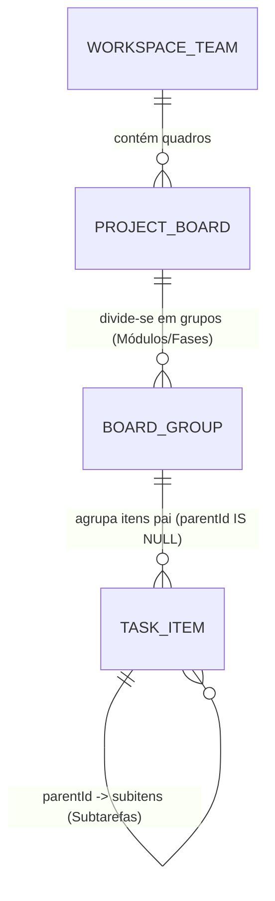

# MedHit WorkTrack v2 — Redesign Estrutural de UX/UI e Motor Hierárquico (Padrão Monday)

*   **Autor:** Lucca G. (MedHit)
*   **Status:** In Review (Auditado e Refinado com EGM)
*   **Data:** 2026-11-04
*   **Ambiente de Trabalho:** Fork Local Isolado (`C:\Users\Lucca\.gemini\antigravity\scratch\medhit-tasks-v2` — branch `v2-local-redesign`)

--------------------------------------------------------------------------------

## Visão Geral (Overview)

O MedHit WorkTrack v1 acumulou dívida visual e estrutural ao tentar combinar elementos de ferramentas de engenharia de software (Linear/Jira, agentes de IA, telemetria, story points, épicos) com uma tabela plana improvisada. O resultado atual apresenta atrito severo de usabilidade para colaboradores de áreas operacionais, pedagógicas e audiovisuais da MedHit.

Este documento define a arquitetura do **MedHit WorkTrack v2**, partindo de um diagnóstico técnico do que deve ser descartado e refeito do zero no fork local (`medhit-tasks-v2`), incorporando os requisitos reais levantados pela equipe de produção de conteúdo no documento de referência (*Monday: pontos positivos e recomendações para a plataforma interna* — `@Sunomono`) e preservando as múltiplas visualizações (Tabela/Lista, Quadro Kanban, Calendário e Visão Geral) com usabilidade imediata para qualquer nível de colaborador.

--------------------------------------------------------------------------------

## O Problema (Diagnóstico Técnico das "Rebarbas" da v1)

Uma auditoria direta no código-fonte atual (`src/components/views/table-view.tsx`, `src/components/layout/sidebar.tsx`, `src/components/layout/topbar.tsx`, `src/server/services/data-store.ts`) revela 6 falhas estruturais que tornam a experiência confusa e inadequada para a operação real da MedHit:

1. **Ausência de Hierarquia Real de 4 Níveis (A Maior Lacuna Operacional):**
   * **Como o time trabalha no Monday (PDF):** `Curso/Quadro` (*Intensivo Primeira Fase 2026.2*) $\rightarrow$ `Grupo/Módulo` (*Módulo 1*) $\rightarrow$ `Item Pai/Semana` (*Semana 1*, com contador de subitens `18` e barra de progresso agregada multicolorida) $\rightarrow$ `Subitem/Aula` (as aulas reais que são gravadas, editadas e liberadas).
   * **Como a v1 foi feita:** Uma tabela plana única (`--list-cols` fixa em 7 colunas) onde "Pastas/Tags" foram misturadas com strings em `task.tags[]`. Não existe agrupamento nativo por Módulos/Grupos na tabela por padrão, não existe árvore expansível de **Item Pai $\rightarrow$ Subitens (Subtarefas)** na própria grade, e as subtarefas foram escondidas como mero checklist textual dentro do painel lateral (`TaskDrawer`), sem dono, sem prazo e sem status próprios.

2. **Modelo Rígido de Coluna Única de Status e Data Única:**
   * **Necessidade real da operação:** Uma única linha (aula ou entregável) passa por múltiplas etapas paralelas ou sequenciais visíveis lado a lado na mesma linha: ex. `Status Gravação` (*Regravado 26.2*, *Reutilizar*), `Status Edição` (*Feito*, *Revisado*), `Aula/Correção`, `Pílula (micro-aula complementar)`, além de duas datas distintas (`Data Limite de Gravação` vs. `Data Liberação`) e colunas de metadados (`Professor` multi-select colorido, `Área Temática` como *CIR*, *GO*, *PED*, *PREV*).
   * **Falha da v1:** O schema de `Task` (`data-store.ts`) suporta apenas um `statusId` e um `dueDate`. Tentar gerenciar produção de conteúdo ou obras com apenas um status por linha força o usuário a criar tarefas duplicadas ou perder visibilidade de qual etapa está travada.

3. **Poluição Visual e "Rebarbas" de Interface (UI Clutter):**
   * **Excesso de barras e controles concorrentes:** O usuário vê simultaneamente `Topbar` (com breadcrumbs redundantes, seletor de simulação de cargo, botão de telemetria, botão "+ Nova Tarefa"), `ProjectToolbar` (com outro título do projeto, outro contador, outro botão "+ Nova Tarefa", botão excluir quadro) e a barra de filtros da `TableView` (com busca local que compete com a busca global, seletores de agrupamento, pastas/tags e ocultar concluídas).
   * **Tooltips invasivos em excesso:** Quase todos os botões foram envelopados em `EducationalTooltip` com caixas de texto longas que disparam ao mover o mouse, causando ruído visual constante.
   * **Páginas órfãs e conceitos de engenharia misturados:** Rotas como `/agents`, `/approvals`, `/automations`, `/squads`, `storyPoints` e `methodology: "scrumban"` coexistem no código e nos tipos, poluindo a arquitetura mental de um gestor de projetos corporativo simples.

4. **Confusão Taxonômica na Sidebar (Áreas vs. Projetos vs. Pastas/Tags):**
   * Na `sidebar.tsx`, "Equipes & Projetos" renderiza Áreas, dentro delas Projetos, e abaixo de cada projeto extrai tags das tarefas fingindo serem pastas (`?folder=tag`). Quando o usuário cria uma "Pasta", na verdade grava uma string em `area.folders` e filtra por tag na tabela. Essa gambiarra quebra a previsibilidade de navegação. No Monday (PDF, pág. 5), a separação é limpa: **Seletor de Time/Workspace** (*Time Audiovisual*, *Time Marketing*, *Produção de Conteúdo*, *Design*) $\rightarrow$ **Pastas/Quadros daquele Time**.

5. **Ausência de Recursos Operacionais de Produtividade Inline:**
   * **Sem indicador de comentários contextual na linha:** No Monday, um ícone de balão com contador ao lado do nome do item abre os comentários e links daquela tarefa/subtarefa diretamente. Na v1, o usuário não sabe quais tarefas têm comentários sem abrir cada uma.
   * **Sem controle de tempo (Time Tracking) e colunas de Links/Duração:** O time audiovisual precisa dar Play/Pause (`▶ 1m 56s`) na própria linha para medir esforço de edição e clicar direto no `Link Drive` ou `Panda Video`.

6. **Fragilidade de Sincronização (`localStorage` vs. Supabase):**
   * A v1 hidrata e sobrescreve estados complexos em chaves do `localStorage` (`medhit_tasks_data_v3`, `medhit_areas_data_v3`, `medhit_members_data_v3`) em paralelo ao Supabase, o que já causou bugs de duplicação de membros (12 "Thiago Ghiraldini") e divergência de dados entre navegadores.

--------------------------------------------------------------------------------

## Auditoria: O Que Manter vs. O Que Refazer do Zero

### 1. O Que Manter (Base Sólida Existente)
*   **Infraestrutura de Autenticação, Convites e E-mail:** Login, controle de sessão, rota `/api/members/invite` integrada ao Resend (`medhit.com.br`) e padronização de identidade (`Nome S.`, ex.: `Lucca G.`, `Thiago G.`).
*   **Conexão Base com Supabase & Servidor MCP (`/api/mcp`):** A camada de comunicação com banco de dados e integração via Model Context Protocol.
*   **As 4 Visualizações Fundamentais do Projeto:**
    1.  **Tabela (Visão Principal estilo Monday):** Grade estruturada por grupos e subitens.
    2.  **Quadro (Kanban):** Cartões arrastáveis agrupados por coluna de status.
    3.  **Calendário:** Visualização mensal de entregas e prazos.
    4.  **Visão Geral (Dashboard):** Gráficos limpos de progresso do quadro.
*   **Suporte a Tema Claro e Escuro (`next-themes`):** Mantido, porém com paleta de cores refinada para alto contraste das etiquetas (pills) de status e áreas, evitando fundos escuros excessivamente carregados de brilho neon (`sky-500/15` em todas as bordas).

### 2. O Que Refazer do Zero (No Fork Local `medhit-tasks-v2`)
*   **Motor de Tabela Hierárquica (Monday Table Engine):** Refazer `table-view.tsx` do zero para suportar nativamente:
    *   **Grupos Colapsáveis com Cor Própria** (ex.: *Módulo 1*, *Fundação & Estrutura*, *Etapa Comercial*).
    *   **Itens Pai com Barra de Progresso Agregada** + expansão inline (`>`) para exibir **Subitens (Subtarefas)** em árvore logo abaixo do item pai, com colunas próprias, responsável, status e datas.
    *   **Células de Status Coloridas Preenchidas (Full-Cell Pills estilo Monday):** Em vez de pequenos badges discretos, células de status com cor de preenchimento nítida e leitura instantânea, suportando múltiplas colunas de status e tags por quadro.
*   **Modelo de Dados de Tarefas e Colunas Customizáveis (`Task` & `BoardColumns`):**
    *   Suporte nativo a `groupId` (Grupo do quadro), `parentId` (Subitem real na tabela com todas as propriedades de uma tarefa), múltiplas colunas de Status/Etiquetas (`customFields` tipados para Professor, Área Temática, Status Secundário, Duplo Prazo, Links Rápidos e Cronômetro Play/Pause).
*   **Navegação Lateral e Topo Unificados (Zero Redundância):**
    *   Unificar `Topbar` e `ProjectToolbar` em um único cabeçalho de projeto limpo (Título do Quadro + Abas de Visualização `Tabela | Quadro | Calendário | Visão Geral` + Busca/Filtro Rápido + Botão `+ Novo Item`), eliminando a dupla barra superior que rouba espaço vertical e confunde o olhar.
    *   Substituir a gambiarra de "Pastas/Tags" na Sidebar por um **Seletor de Espaço de Trabalho / Time** claro no topo da Sidebar (*Produção de Conteúdo*, *Time Audiovisual*, *Marketing*, *Operações / Casa MedHit*) seguido pelos Quadros reais daquele time.
*   **Camada de Persistência Unificada (Single Source of Truth):**
    *   Eliminar o cache concorrente de `localStorage` para dados de negócio; usar `localStorage` **estritamente** para preferências visuais do usuário (ex.: lista de IDs de grupos colapsados na UI).

--------------------------------------------------------------------------------

## Objetivos (Goals)

*   **G1 — Hierarquia de 4 Níveis Intuitiva:** Permitir organizar qualquer projeto em `Time (Workspace)` $\rightarrow$ `Quadro (Projeto)` $\rightarrow$ `Grupo (Módulo/Fase)` $\rightarrow$ `Item Pai` $\rightarrow$ `Subitem (Subtarefa expansível na tabela)`, com barra visual de progresso agregada no item pai.
*   **G2 — Edição Inline Rápida Estilo Planilha (Monday UX):** Permitir alterar Status (com cores sólidas semânticas), Múltiplos Responsáveis/Professores, Área Temática (tags coloridas), Datas Limite (Gravação/Entrega e Liberação), Links e Cronômetro (Play/Pause) diretamente nas células da linha com 1 clique, sem precisar abrir modais.
*   **G3 — Delegação e Comentários Contextuais por Item e Subitem:** Exibir contador de comentários (ícone de balão) diretamente na célula do título de cada item e subitem, abrindo a conversa contextual e links em um painel lateral limpo.
*   **G4 — Consistência entre as 4 Visualizações (`Tabela`, `Quadro`, `Calendário`, `Visão Geral`):** Garantir que os mesmos itens, grupos e subitens criados na Tabela reflitam instantaneamente no Kanban, no Calendário de Prazos e nos indicadores da Visão Geral.
*   **G5 — Usabilidade Zero-Fricção para Qualquer Colaborador:** Reduzir a densidade de botões na tela em pelo menos 40% (unificando cabeçalhos, removendo jargões técnicos e eliminando tooltips repetitivos), garantindo que qualquer colaborador entenda como criar um item, abrir subitens e atualizar seu status em menos de 10 segundos.

--------------------------------------------------------------------------------

## Não-Objetivos (Non-Goals)

*   **NG1 — Ferramentas de Engenharia de Software (Scrum/Jira):** Não vamos manter nem exibir conceitos de *Story Points*, *Sprints*, *Velocity*, *Burndown*, *Épicos* ou *Scrumban* na interface.
*   **NG2 — Automação Complexa de Agentes Autônomos na UI Principal:** As telas de gerenciamento de agentes de IA (`/agents`, `/approvals`, `/automations`) e telemetria técnica não farão parte da navegação dos colaboradores; a integração MCP continuará funcionando silenciosamente via API em background.
*   **NG3 — Edição de Vídeo ou Armazenamento de Arquivos Pesados no Banco:** Colunas de mídia armazenarão links estruturados (`Link Drive`, `Panda Video`, documentos) e metadados de duração/cronômetro, sem upload direto de arquivos de vídeo gigabyte no Supabase.
*   **NG4 — Deploy Imediato em Produção (`work.medhit.click`):** Nenhuma alteração será publicada no domínio de produção durante a construção e validação. Todo o desenvolvimento ocorrerá exclusivamente no fork local (`medhit-tasks-v2`) até aprovação explícita.

--------------------------------------------------------------------------------

## Questões em Aberto (Resolvidas pelo Comitê EGM)

1.  **Templates de Quadro vs. Motor Genérico (YAGNI):** Em vez de construir um motor de custom fields genérico estilo Airtable, adotamos **2 templates operacionais pré-definidos**:
    *   *Produção de Conteúdo / Aulas (Monday):* Colunas para Professor, Área Temática (especialidades médicas: *CIR, GO, PED, PREV, CLI*), Status Gravação, Status Edição, Pílula, Data Limite, Data Liberação, Duração e Links Drive/Panda.
    *   *Gestão Geral / Obras (CASA MEDHIT 2026):* Colunas para Responsável, Status de Execução, Prioridade, Prazo Limite, Fornecedor/Orçamento e Links de Projeto.
2.  **Comportamento de Subitens no Kanban e Calendário:**
    *   *No Kanban:* Cartões primários representam Itens Pai (`!task.parentId`), exibindo um badge/barra de progresso dos seus subitens. Há um filtro/toggle no toolbar caso o usuário queira inspecionar diretamente os subitens.
    *   *No Calendário:* São plotados os Itens Pai com base em seu `dueDate`. Subitens que possuem datas específicas de gravação/liberação são exibidos como eventos filhos vinculados.
3.  **Coluna que Rege a Barra de Progresso:** No template de Produção de Conteúdo, a barra de progresso agregada é regida pelo `Status Edição` (etapa final de entrega da aula).

--------------------------------------------------------------------------------

## Jornadas Críticas do Usuário (Critical User Journeys — CUJs)

### CUJ 1: Gestão de Semanas e Aulas em Árvore (Hierarquia de 4 Níveis)
*   **Dado (Given):** Um colaborador acessa o Time `Produção de Conteúdo` (ou `Operações MedHit`) e abre o quadro `Intensivo Primeira Fase 2026.2` (ou `CASA MEDHIT 2026`).
*   **Quando (When):** Ele visualiza o Grupo `Módulo 1` (ou `1. Fundação & Estrutura`), clica na seta `>` do Item Pai `Semana 1` (que exibe o badge `18 subitens` e uma barra de progresso agregada multicolorida) e adiciona ou edita um Subitem (`Trauma e Cirurgia Geral`).
*   **Então (Then):** A sub-tabela de subitens expande inline imediatamente abaixo do Item Pai; alterar o `Status Gravação` ou `Status Edição` de qualquer subitem recalcula em tempo real a barra de progresso agregada do Item Pai e o resumo no rodapé do Grupo.

### CUJ 2: Edição Rápida Multicélula e Cronômetro Inline (Time Audiovisual / Operação)
*   **Dado (Given):** Um editor audiovisual está na linha de uma aula com `Status Gravação = Regravado 26.2`.
*   **Quando (When):** Ele clica no botão `▶ Play` da coluna `Controle de Tempo` ao iniciar a edição, cola o link na coluna `Link Drive` / `Panda`, altera `Status Edição` para `Feito` (célula verde sólida) e pausa o cronômetro (`⏸ 42m 15s`).
*   **Então (Then):** Todas as alterações são salvas instantaneamente com 1 clique na própria linha (sem modais intermediários), o tempo acumulado é computado localmente por delta de timestamps sem re-renderizar a tabela inteira, e qualquer outro timer ativo do usuário é pausado automaticamente.

### CUJ 3: Comentários Contextuais e Delegação Rápida na Linha
*   **Dado (Given):** Um coordenador quer revisar observações ou cobrar um subitem específico.
*   **Quando (When):** Ele vê o ícone de balão de conversa com contador (`💬 3`) ao lado do nome do subitem na tabela e clica nele.
*   **Então (Then):** O painel lateral (`TaskDrawer`) abre focado diretamente na aba de Conversa & Links daquele subitem, permitindo mencionar ou atribuir um membro (`Lucca G.`, `Thiago G.`) imediatamente.

### CUJ 4: Alternância Fluida entre Tabela, Kanban, Calendário e Visão Geral
*   **Dado (Given):** O gestor está no quadro `CASA MEDHIT 2026` ou `Intensivo 2026.2`.
*   **Quando (When):** Ele alterna no cabeçalho unificado entre `Tabela`, `Quadro (Kanban)`, `Calendário` e `Visão Geral`.
*   **Então (Then):**
    *   Na **Tabela**, vê os Grupos coloridos, Itens Pai e Subitens expansíveis com todas as colunas do template do quadro.
    *   No **Quadro (Kanban)**, vê os cartões agrupados pelo Status Principal dos Itens Pai com barra de progresso dos subitens no cartão.
    *   No **Calendário**, vê as entregas posicionadas nas datas limite (`Prazo Principal` e `Data de Liberação`).
    *   Na **Visão Geral**, vê as métricas consolidadas por Grupo, Status e Responsável.

--------------------------------------------------------------------------------

## Plano Técnico (Arquitetura)

### 1. Arquitetura Visual e Layout Unificado (Eliminação de "Rebarbas")

Substituiremos a pilha atual de 3 barras horizontais (`Topbar` + `ProjectToolbar` + `FilterBar`) por um **Shell de 2 Regiões Limpas**:
1.  **Sidebar Esquerda Enxuta (`240px` colapsável):**
    *   **Seletor de Time / Workspace no Topo:** Dropdown claro com ícone e cor do Time ativo (*Produção de Conteúdo*, *Audiovisual*, *Marketing*, *Operações & Obras*). Trocar de time filtra imediatamente a lista de quadros abaixo.
    *   **Acesso Rápido Pessoal:** `Início` e `Minhas Tarefas` (com badge de pendências atribuídas ao usuário logado).
    *   **Lista de Quadros do Time:** Lista limpa dos quadros do time ativo + botão `+ Novo Quadro`.
    *   **Rodapé Compacto:** Avatar do usuário (`Lucca G.`), alternador de Tema Claro/Escuro, Membros e Ajuda.
2.  **Cabeçalho Único do Quadro (`BoardHeader`):**
    *   Linha única contendo: **Título do Quadro** + **Abas das 4 Visões (`Tabela`, `Quadro`, `Calendário`, `Visão Geral`)** + **Busca & Filtro de Pessoa/Status inline** + **Botão primário `+ Novo Item`** (com dropdown `+ Novo Grupo`).
    *   A `Topbar` global é suprimida condicionalmente dentro das páginas de projeto (`[view]/page.tsx`), devolvendo 56px de espaço vertical útil à área de trabalho.

```text
+--------------------------------------------------------------------------------------------------+
| SIDEBAR (240px)          | CABEÇALHO ÚNICO DO QUADRO (BoardHeader - 56px)                        |
| ------------------------ | [CASA MEDHIT 2026]  [Tabela | Quadro | Calendário | Visão Geral]      |
| [Time: Operações MedHit v]|                     [🔍 Buscar] [👤 Pessoa] [⚡ Status] [+ Novo Item] |
|                          +-----------------------------------------------------------------------+
| * Início                 | ÁREA DE CONTEÚDO DA VISÃO ATIVA (Monday Table Engine)                 |
| * Minhas Tarefas         |                                                                       |
|                          | v GRUPO 1: FUNDAÇÃO & ESTRUTURA (Cor: Azul | 3 Itens | 12 Subitens)   |
| QUADROS DO TIME        + | --------------------------------------------------------------------- |
| # CASA MEDHIT 2026       | [v] > Semana 1 / Terraplanagem [3] [💬2] | Lucca G. | [EM ANDAMENTO]  |
| # Cronograma Fornecedores|     |-- Topografia e Sondagem      [💬1] | Thiago G.| [FEITO]         |
|                          |     |-- Escavação das Sapatas            | Lucca G. | [EM ANDAMENTO]  |
|                          |     +-- + Adicionar subitem...                                        |
| ------------------------ | + Adicionar item no grupo...                                          |
| [Lucca G.] [☀/🌙] [⚙]    | [Barra de Progresso Agregada do Grupo: 65% Feito | 25% Andamento]     |
+--------------------------------------------------------------------------------------------------+
```

### 2. Modelo de Dados Hierárquico e Isolamento de Persistência

Para suportar a hierarquia sem os riscos levantados na auditoria técnica (Zero acoplamento em `ai_context` e prevenção de lost updates):



#### Novas Interfaces Principais (`src/server/services/data-store.ts`):

1.  **`BoardGroup` (Grupos Coloridos do Quadro):**
    *   `id: string`
    *   `projectId: string`
    *   `name: string`
    *   `color: string` (ex.: `#0ea5e9`, `#10b981`, `#8b5cf6`, `#f59e0b`)
    *   `position: number`
    *   `collapsed?: boolean`

2.  **Extensão de `Task` (Item Pai e Subitem):**
    *   `groupId?: string` — vincula o item a um `BoardGroup`.
    *   `parentId?: string` — quando preenchido, renderizado como **Subitem** dentro da árvore expansível do Item Pai na `TableView`.
    *   `customFields?: TaskCustomFields` — campos de negócio tipados:
        *   `secondaryStatus?: string` (Status Edição)
        *   `pillStatus?: string` (Pílula / Correção)
        *   `areaTag?: string` (Área Temática médica ou de obra)
        *   `professors?: string[]` (multi-select de responsáveis/professores)
        *   `releaseDate?: string` (Data Liberação)
        *   `timeSpentSeconds?: number` (tempo acumulado em segundos)
        *   `timerRunningSince?: string | null` (timestamp ISO de início do timer ativo)
        *   `driveUrl?: string` e `videoUrl?: string` (links diretos)
        *   `durationText?: string` (ex.: `"00:49:30"`)

#### Contrato Defensivo de Persistência no Supabase (`src/lib/supabase.ts`):
*   **Regra de Ouro:** Não poluir o texto puro de prompts de IA.
*   **Serialização:** Os metadados v2 são salvos em formato JSON estruturado com flag `__medhit_v2: true`.
*   **Desserialização com Fallback Seguro:**
    ```ts
    try {
      if (row.ai_context && row.ai_context.startsWith("{")) {
        const parsed = JSON.parse(row.ai_context);
        if (parsed && parsed.__medhit_v2) {
          task.groupId = parsed.groupId;
          task.customFields = parsed.customFields;
          task.aiContext = parsed.originalText || "";
        }
      }
    } catch {
      // Tarefa legada sem metadados v2: preserva ai_context como texto puro sem estourar exceção
      task.aiContext = row.ai_context;
    }
    ```

### 3. Engenharia de Componentes da Tabela e Isolamento de Performance

Para evitar o *Re-render Hell* diagnosticado pelo comitê técnico:
*   **`TimeTrackerCell` Desacoplado:** O cronômetro opera exclusivamente como nó folha. Ao clicar em `▶ Play`, o `task-context` registra `timerRunningSince = new Date().toISOString()`. A contagem visual de segundo a segundo roda em um hook local no próprio `TimeTrackerCell` via `setInterval(..., 1000)` baseado no delta `Date.now() - timerRunningSince`. Nenhum tick de segundo é enviado ao estado global da tabela.
*   **Regra de Timer Único:** Dar play em uma tarefa pausa automaticamente qualquer outra tarefa com timer rodando no mesmo cliente, acumulando o delta em `timeSpentSeconds`.
*   **Memoização das Linhas:** As linhas de `ItemRow` e `SubtaskRow` são encapsuladas com `React.memo`, re-renderizando apenas quando suas próprias propriedades sofrem mutação.
*   **Células Estilo Monday:** Pílulas com preenchimento de cor total (Full-Fill Status Cells) com texto em alto contraste e seletores rápidos sem truncamento.

--------------------------------------------------------------------------------

## Plano de Implementação Detalhado (Detailed Implementation Plan)

Todos os arquivos abaixo pertencem ao fork local `C:\Users\Lucca\.gemini\antigravity\scratch\medhit-tasks-v2`.

### Arquivos Alvo para Criar / Modificar

#### 1. `./src/server/services/data-store.ts` ([Modify])
*   **Tipo / Escopo:** Modelo de Dados e Tipagens TypeScript Core.
*   **Mudanças Propostas:**
    *   Definir as interfaces `BoardGroup` e `TaskCustomFields`.
    *   Estender `Project` com `template: "general" | "content_production"` e `groups: BoardGroup[]`.
    *   Estender `Task` com `groupId?: string` e `customFields?: TaskCustomFields`.
*   **Justificativa:** Estabelece o contrato de dados tipado para a hierarquia de 4 níveis.

#### 2. `./src/server/db/seed.ts` ([Modify])
*   **Tipo / Escopo:** Dados Iniciais de Demonstração e Templates Operacionais.
*   **Mudanças Propostas:**
    *   Estruturar os Times (`Operações & Obras MedHit`, `Produção de Conteúdo`, `Audiovisual & Design`, `Marketing & Growth`).
    *   Configurar o quadro **`CASA MEDHIT 2026`** com 3 `BoardGroups` coloridos (*1. Fundação & Estrutura*, *2. Instalações & Acabamentos*, *3. Mobiliário & Inauguração*), Itens Pai com Subitens vinculados via `parentId`, responsáveis (`Lucca G.`, `Thiago G.`), prazos e links.
    *   Configurar o quadro **`Intensivo Primeira Fase 2026.2`** reproduzindo o fluxo do Monday: Grupos (*Módulo 1*, *Módulo 2*), Itens Pai (*Semana 1*, *Semana 2*) e Subitens com `Professor`, `Área Temática`, `Status Gravação`, `Status Edição`, `Pílula`, `Data Limite`, `Data Liberação` e links `Drive`/`Panda`.
*   **Justificativa:** Fornece fixtures completas e imediatas para validação visual no fork local.

#### 3. `./src/lib/supabase.ts` ([Modify])
*   **Tipo / Escopo:** Adaptador de Persistência e Serialização Defensiva.
*   **Mudanças Propostas:**
    *   Atualizar `mapTaskToRow` e `mapRowToTask` com bloco defensivo `try/catch` para serializar e desserializar `groupId` e `customFields` sem quebrar tarefas legadas.
*   **Justificativa:** Garante integridade referencial e evita que tarefas com texto puro no banco causem quebras de renderização.

#### 4. `./src/context/task-context.tsx` ([Modify])
*   **Tipo / Escopo:** Provedor de Estado Global Reativo.
*   **Mudanças Propostas:**
    *   Adicionar métodos para grupos: `createGroup(projectId, name, color)`, `updateGroup(projectId, groupId, updates)`, `deleteGroup(projectId, groupId)` (com política de desvincular tarefas para "Tarefas Sem Grupo").
    *   Adicionar método `createSubtask(parentId, title, initialFields)` com herança automática de `projectId`, `areaId` e `groupId` do pai.
    *   Adicionar método `toggleTaskTimer(taskId)` que gerencia o início/fim com política de timer único por usuário.
    *   Restringir `localStorage` estritamente a preferências de UI (ex.: `medhit_collapsed_groups`).
*   **Justificativa:** Centraliza o gerenciamento de estado sem degradar a performance.

#### 5. `./src/app/(workspace)/layout.tsx` ([Modify])
*   **Tipo / Escopo:** Shell Principal de Layout.
*   **Mudanças Propostas:**
    *   Tornar a exibição da `Topbar` condicional: suprimir a `Topbar` quando a rota estiver dentro de um quadro de projeto (`/[area]/[project]/...`), permitindo que o `BoardHeader` assuma a barra superior sem concorrência de cabeçalhos.
*   **Justificativa:** Elimina a duplicidade de barras superiores diagnosticada pelo comitê técnico.

#### 6. `./src/components/layout/sidebar.tsx` ([Modify])
*   **Tipo / Escopo:** Navegação Lateral Principal.
*   **Mudanças Propostas:**
    *   Substituir a listagem confusa de pastas/tags por um **Seletor de Time / Workspace** no topo.
    *   Listar apenas `Início`, `Minhas Tarefas` e os **Quadros do Time Ativo** (com botão `+ Novo Quadro`).
    *   Consolidar no rodapé o perfil do usuário (`Lucca G.`), alternador de tema e ajuda.
*   **Justificativa:** Corrige a confusão taxonômica e reproduz a simplicidade da Sidebar do Monday.

#### 7. `./src/components/layout/project-toolbar.tsx` ([Modify])
*   **Tipo / Escopo:** Cabeçalho Unificado do Quadro (`BoardHeader`).
*   **Mudanças Propostas:**
    *   Consolidar em uma barra única (`56px`): Título do Quadro, Abas das 4 Visões (`Tabela`, `Quadro`, `Calendário`, `Visão Geral`), Busca rápida, Filtro de Responsável/Status e botão `+ Novo Item / Grupo`.
    *   Remover tooltips invasivos que bloqueavam a visualização.
*   **Justificativa:** Libera espaço vertical e concentra todas as ações contextuais do projeto em um só lugar.

#### 8. `./src/app/(workspace)/[area]/[project]/[view]/page.tsx` ([Modify])
*   **Tipo / Escopo:** Rota de Visualização do Quadro.
*   **Mudanças Propostas:**
    *   Separar explicitamente tarefas pai (`!t.parentId`) e subitens (`t.parentId !== undefined`) antes de repassar para as visualizações.
    *   Integrar as ações de criação rápida com suporte ao `groupId`.
*   **Justificativa:** Garante que subitens não sejam duplicados como cartões de primeiro nível no Kanban e no Calendário.

#### 9. `./src/components/views/table-view.tsx` ([Modify — Reescrita Modular])
*   **Tipo / Escopo:** Motor de Tabela Hierárquica Monday (`MondayTableView`).
*   **Mudanças Propostas:**
    *   Renderizar seções por **`BoardGroup`** com cabeçalho colorido colapsável e botão `+ Novo Grupo`.
    *   Renderizar **Itens Pai** com expansão inline (`>`), contador de subitens, ícone de comentários (`💬`) e **Barra de Progresso Agregada** multicolorida.
    *   Renderizar **Sub-tabela de Subitens** em árvore expansível logo abaixo do item pai.
    *   Células com preenchimento total de cor (Full-Fill Pills) para Status de Gravação/Edição e Pílulas.
    *   Célula de cronômetro (`TimeTrackerCell`) com cálculo local desacoplado.
*   **Justificativa:** Implementa 100% dos requisitos operacionais do Monday com alta performance.

#### 10. `./src/components/boards/kanban-board.tsx`, `./src/components/views/calendar-view.tsx` e `./src/app/(workspace)/[area]/[project]/dashboard/page.tsx` ([Modify])
*   **Tipo / Escopo:** Visões Complementares.
*   **Mudanças Propostas:**
    *   Kanban: exibir cartões de Itens Pai com barra de progresso de subitens e badge de Grupo.
    *   Calendário: plotar prazos de entrega e liberação com cores dos grupos.
    *   Visão Geral: consolidar métricas por Grupo e por Status.
*   **Justificativa:** Mantém coerência nas 4 visualizações do sistema.

#### 11. `./src/__tests__/monday-workflow.test.ts` ([Modify])
*   **Tipo / Escopo:** Suíte de Testes Automatizados (Vitest).
*   **Mudanças Propostas:**
    *   Testar serialização defensiva em `mapRowToTask/mapTaskToRow` (strings legadas, JSON vazio, payload v2).
    *   Testar herança de `createSubtask` (`projectId`, `areaId`, `groupId`).
    *   Testar cálculo de agregação de progresso com subitens concluídos, parciais e vazios.
*   **Justificativa:** Assegura regressão zero e robustez de ponta a ponta.

--------------------------------------------------------------------------------

### Plano de Verificação (Verification Plan)

*   **Checagem de Tipos:** `pnpm.cmd typecheck` em `C:\Users\Lucca\.gemini\antigravity\scratch\medhit-tasks-v2`.
*   **Testes Automatizados:** `pnpm.cmd test` (todas as suítes Vitest aprovadas).
*   **Build Local:** `pnpm.cmd build` no fork local para validar compilação limpa do Next.js.
*   **Servidor Local Interativo:** `pnpm.cmd dev` na porta `3000` para validação humana direta pelo autor no navegador.

--------------------------------------------------------------------------------

*Drafted & Audited with EGM*
